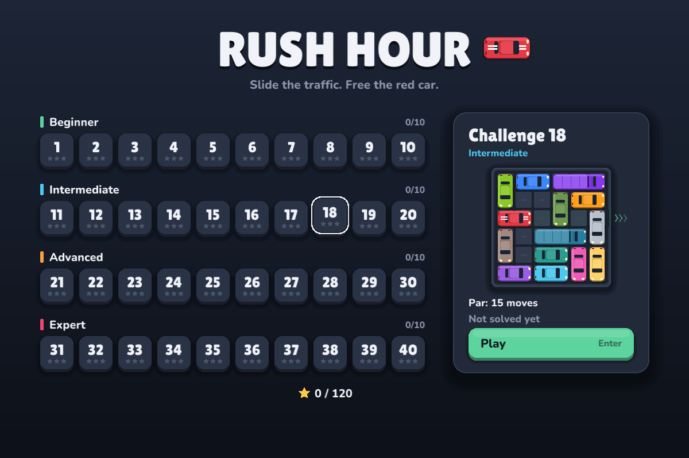
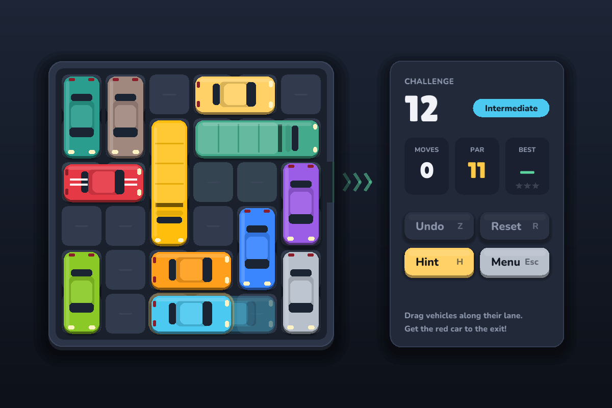
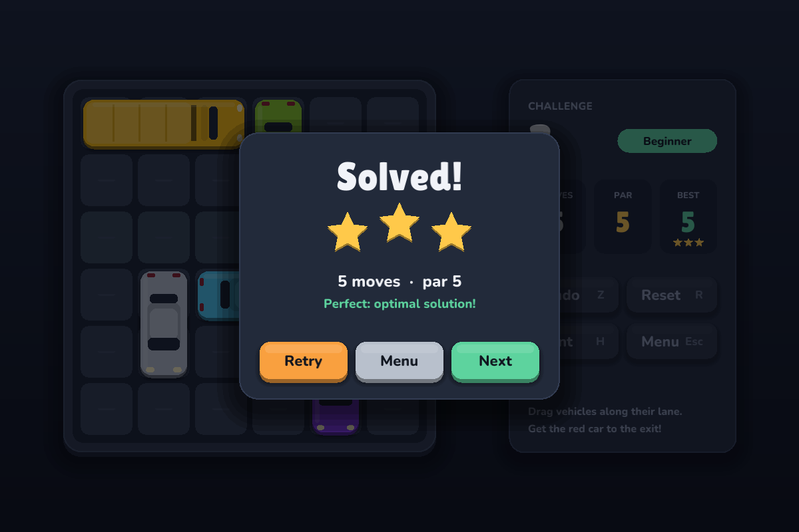

# 🚗 Rush Hour

A Rush Hour sliding-block puzzle for the desktop, written in Rust.

Slide the traffic out of the way and get the red car through the exit on the
right. The fewer moves you use, the more stars you earn.





## Features

- The official rules: a 6×6 grid, 2-cell cars and 3-cell trucks, sliding only
  along their own lane. **One slide of any length = one move.**
- **40 original challenges** in 4 tiers: Beginner (par 3–8), Intermediate (10–17),
  Advanced (18–27) and Expert (29–46). A solver proves every par is the true
  minimum.
- Drag-and-drop with smooth snapping, undo, reset, and a **hint** from the
  built-in optimal solver.
- 1–3 stars against par. Best results are saved between sessions.
- A night car-park look, an animated exit, and confetti when you win. Runs at
  60 fps in a single ~1.7 MB binary.

## Play

```bash
# Linux (Fedora) needs:  sudo dnf install libX11-devel libXi-devel mesa-libGL-devel
cargo run --release -p rush-hour
```

| Action | Mouse | Keys |
|---|---|---|
| Move a vehicle | drag it | — |
| Undo | Undo button | Z / U / Backspace |
| Reset | Reset button | R |
| Hint | Hint button | H |
| Back to menu | Menu button | Esc |
| Next challenge (after a win) | Next button | Enter / N |
| Select a challenge (in the menu) | click | arrow keys, then Enter |

## Project layout

| Path | What's there |
|---|---|
| `crates/rush-core` | Pure rules, BFS solver, level format and generator. No dependencies, fully tested. |
| `crates/rush-hour` | The desktop app, built on macroquad. |
| `crates/rush-core/assets/levels.txt` | The 40 challenges, as human-readable text. |
| `specs/001-rush-hour-game/` | Spec Kit spec, plan, research, data model, contract and tasks. |
| `.specify/memory/constitution.md` | The project rules. |

```bash
cargo test --workspace --release
cargo run --release -p rush-core --bin levelgen -- 240 2026 > crates/rush-core/assets/levels.txt
```

## Credits

The original Rush Hour® puzzle was designed by Nob Yoshigahara and is published
by ThinkFun. This is an unofficial fan implementation, and all challenges are
original. Fonts: Lilita One and Nunito, both under the SIL Open Font License (see
`crates/rush-hour/assets/`).
